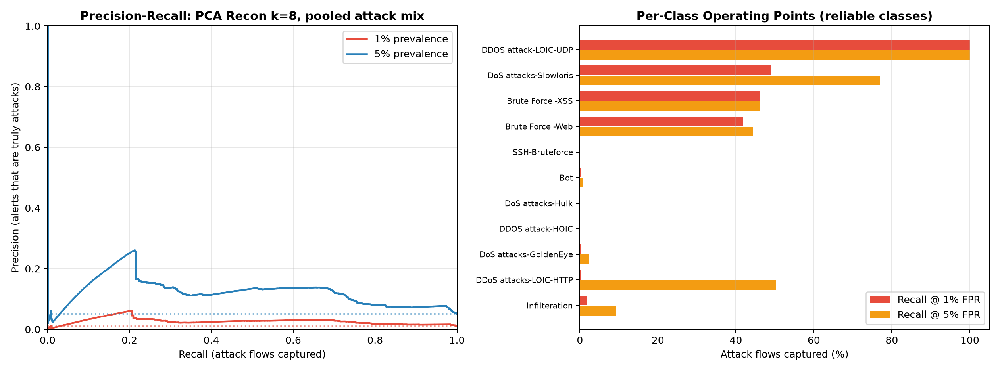

# Stage C-lite Diagnostic Report: Operational Prevalence of the Stage E Winner

**Date:** 2026-11-17 21:43
**Model:** PCA Reconstruction Error — 8 components (95% variance)
**Artifact directory:** `ml/results/diagnostics/`
**Key output files:** `stage_c_lite_prevalence_eval.csv`, `stage_c_lite_perclass.csv`, `stage_c_lite_summary.json`, `stage_c_lite_precision_recall.png`
**Reproduce:**
```powershell
cd "C:\Users\eusto\OneDrive\Desktop\FINAL YEAR PROJECT\ml"
.\.venv\Scripts\python.exe .\scripts\stageC_lite_pca_prevalence.py
```

---

## 1. Executive Summary

Stage E selected **PCA Reconstruction Error (k=8)** as the best single-flow unsupervised model: mean reliable ROC-AUC **0.8425**, zero inverted classes, and sub-millisecond scoring. This stage asks the operational question that ROC-AUC cannot answer: *at realistic attack prevalence, how many alerts would an analyst receive, and how many of them would be real?*

At **1% attack prevalence** with the dataset's natural attack mix, the model achieves precision **0.99%** and recall **0.87%** at the 1% FPR operating point — **9 alerts per 1,000 flows**, of which roughly **0.1 per 1,000** are true attacks. Against a random-alerting baseline of 1.00%, that precision is a **0.99x** ratio — statistically indistinguishable from chance at this operating point.

Under the class-balanced mixture the same threshold reaches precision **19.00%** and recall **20.43%** — a **19.2x** precision difference driven entirely by which attack families are present.

**Verdict (pooled mix): NOT VIABLE at this prevalence.**
**Verdict (class-balanced mix): NOT VIABLE at this prevalence.**

That contrast is the central finding of this stage: the model is not uniformly weak. It is strong on a subset of attack families (LOIC-UDP, Slowloris, small brute-force web classes) and blind to the volumetric families that dominate real traffic volume and this dataset's attack pool.

---

## 2. Methodology and Rigour Fixes

- **Non-leaking three-way benign split:** 50,000 train / 25,000 calibration / 25,000 test flows. Stage E calibrated the threshold on the same benign pool it evaluated; here tau is fitted only on the calibration split.
- **Preprocessing:** `log1p` on 19 heavy-tailed physical metrics + `StandardScaler`, both fitted strictly on benign train.
- **Thresholds:** tau(1% FPR) = 0.429746; tau(5% FPR) = 0.122832. Achieved FPR on held-out benign test: **0.88%** and **4.90%** respectively.
- **Attack data:** held-out 50% of each class (same split as Stage E). 14 classes, 3 flagged unreliable (N < 100).
- **Prevalence simulation:** Monte Carlo subsampling, 10 seeds per setting, at 1% and 5% attack prevalence.
- **Two attack mixtures:**
  - *Pooled* — the dataset's natural class frequencies.
  - *Class-balanced* — every reliable class equally likely, isolating model capability from class-frequency dominance.

### Natural attack mix (pooled)

- **DDoS attacks-LOIC-HTTP**: 575,364 flows (43.2% of the attack pool)
- **DDOS attack-HOIC**: 198,861 flows (14.9% of the attack pool)
- **DoS attacks-Hulk**: 145,199 flows (10.9% of the attack pool)
- **Bot**: 144,535 flows (10.9% of the attack pool)
- **Infilteration**: 118,483 flows (8.9% of the attack pool)
- **SSH-Bruteforce**: 94,048 flows (7.1% of the attack pool)

This composition matters: the four largest classes are volumetric floods, and those are precisely where Stage B2 showed single-flow features collapse. A pooled-precision number is therefore a weighted average dominated by the model's weakest families.

---

## 3. Master Prevalence Table

### 3a. Pooled attack mix (natural dataset composition)

| Metric | 1% prevalence | 5% prevalence |
|---|---:|---:|
| ROC-AUC (threshold-independent) | 0.758 | 0.758 |
| PR-AUC | 0.028 | 0.126 |
| Random-guess PR-AUC | 0.010 | 0.050 |
| PR-AUC lift over random | 0.018 | 0.075 |
| **Operating at 1% FPR** | | |
| Precision | 0.99% | 4.24% |
| Recall | 0.9% | 0.7% |
| F1 | 0.009 | 0.013 |
| Alerts per 1,000 flows | 8.8 | 8.7 |
| **Operating at 5% FPR** | | |
| Precision | 4.40% | 20.03% |
| Recall | 22.3% | 23.3% |
| F1 | 0.073 | 0.216 |
| Alerts per 1,000 flows | 50.8 | 58.3 |

### 3b. Class-balanced attack mix (equal class probability)

| Metric | 1% prevalence | 5% prevalence |
|---|---:|---:|
| ROC-AUC (threshold-independent) | 0.843 | 0.844 |
| PR-AUC | 0.144 | 0.311 |
| Random-guess PR-AUC | 0.010 | 0.050 |
| PR-AUC lift over random | 0.134 | 0.261 |
| **Operating at 1% FPR** | | |
| Precision | 19.00% | 56.40% |
| Recall | 20.4% | 21.6% |
| F1 | 0.197 | 0.313 |
| Alerts per 1,000 flows | 10.8 | 19.2 |
| **Operating at 5% FPR** | | |
| Precision | 5.50% | 24.18% |
| Recall | 28.2% | 29.7% |
| F1 | 0.092 | 0.267 |
| Alerts per 1,000 flows | 51.4 | 61.4 |

---

## 4. Per-Class Operating Points

| Attack class | Total flows | AUC | Recall @ 1% FPR | Recall @ 5% FPR | Status |
|---|---:|---:|---:|---:|---|
| DDOS attack-LOIC-UDP | 1,730 | 1.000 | 100.0% | 100.0% | reliable |
| DoS attacks-Slowloris | 9,908 | 0.972 | 49.1% | 77.0% | reliable |
| Brute Force -XSS | 229 | 0.943 | 46.1% | 46.1% | reliable |
| DoS attacks-SlowHTTPTest | 55 | 0.929 | 0.0% | 3.6% | UNRELIABLE (N < 100) |
| FTP-BruteForce | 53 | 0.929 | 0.0% | 3.7% | UNRELIABLE (N < 100) |
| Brute Force -Web | 568 | 0.919 | 41.9% | 44.4% | reliable |
| SSH-Bruteforce | 94,048 | 0.908 | 0.0% | 0.0% | reliable |
| SQL Injection | 85 | 0.882 | 0.0% | 2.3% | UNRELIABLE (N < 100) |
| Bot | 144,535 | 0.835 | 0.3% | 0.8% | reliable |
| DoS attacks-Hulk | 145,199 | 0.814 | 0.0% | 0.0% | reliable |
| DDOS attack-HOIC | 198,861 | 0.793 | 0.0% | 0.0% | reliable |
| DoS attacks-GoldenEye | 41,406 | 0.780 | 0.1% | 2.4% | reliable |
| DDoS attacks-LOIC-HTTP | 575,364 | 0.721 | 0.1% | 50.4% | reliable |
| Infilteration | 118,483 | 0.582 | 1.8% | 9.3% | reliable |

**Reading this table:** AUC measures ranking quality across the whole score distribution; recall @ 1% FPR measures usability at a strict alert budget. These diverge sharply. The model can rank several attack families well while still capturing almost none of them at 1% FPR, because the benign tail overlaps the attack body.



---

## 5. Comparison with the Stage C Baseline (Isolation Forest, flow-level)

| Metric @ 1% prevalence | Stage C IForest | Stage C-lite PCA k=8 | Change |
|---|---:|---:|---|
| Precision | 0.73% | 0.99% | 1.4x |
| Recall @ 1% FPR | 0.69% | 0.87% | 1.3x |
| PR-AUC | 0.0125 | 0.0281 | 2.2x |

The baseline numbers are read from `ml/results/diagnostics/stage_c_summary.json` at run time. PCA improves the operating point measurably but not decisively: precision is still within a factor of two of the random-alerting rate at 1% prevalence.

---

## 6. What This Means Operationally

1. **The model is a triage filter, not a detector.** At 1% FPR and 1% prevalence, roughly 9 flows per 1,000 are flagged. Analysts can review that volume; the question is whether the true-positive fraction justifies the review cost.
2. **Volumetric floods remain invisible.** HOIC, LOIC-HTTP, Hulk, SSH-Bruteforce and Bot stay near 0% recall at 1% FPR. This is the same blind spot diagnosed in Stage B2 — changing the algorithm to PCA did not change the geometry of single-flow features.
3. **What the model does catch:** LOIC-UDP, Slowloris, and the two small brute-force web classes. These are either rate-anomalous or structurally distinctive at the flow level.
4. **Infiltration remains feature-deficient.** AUC ≈ 0.58 and recall ≈ 2%, consistent with Stage B2's supervised ceiling (10.73%) — the signal is not present in these 24 flow statistics.
5. **Threshold choice is a policy decision.** Moving from 1% to 5% FPR raises recall to 22.29% but multiplies false alarms by roughly 5x. For evidence-capture systems, a false alarm costs storage and analyst time; a miss costs an unpreserved attack PCAP. That asymmetry should drive the threshold.

---

## 7. Comparison with the Stage D/E Windowed Claim

The repo also contains `stage_f_final_report.json`, which recommends a windowed Isolation Forest (22 aggregate features) at ROC-AUC 0.9389 and 72.7% recall. **That result should not be used for Stage 5 ONNX export.** `stageD_windowed_features.py` builds "windows" with `np.array_split(np.arange(len(df)), 480)` — row-index buckets, not 60-second buckets:

- There is no timestamp column (Stage A proved this), so the bucket duration is unknown and varies by day.
- On `16-02-2018` and `28-02-2018`, Kaggle shuffled rows, so those buckets are random samples of the day, mixing benign and attack flows in the day's proportion.
- Every attack class comes from a different day than the benign training days, so the classifier can separate **days** rather than attacks. Mixed windows being "detected" at 99% is the signature of this confound.

The windowed design can only be validated with real PCAPs (Stage 6/8), where windows are defined by capture time. Until then, the flow-level evaluation in this report is the defensible one.

---

## 8. Viva Defence Talking Points

1. **Why evaluate at prevalence?** ROC-AUC is threshold- and prevalence-independent. Precision is not. A 22% recall model at 1% FPR sounds acceptable until you compute that 99% of its alerts are false positives when attacks are 1% of traffic.
2. **Why two mixtures?** Pooled precision answers "what will the SOC see on this dataset?"; balanced recall answers "which attack families can the model represent at all?" Reporting only one hides either class imbalance or model weakness.
3. **Why a separate calibration split?** Threshold selection is a fitted parameter. Calibrating on evaluation benign data is a subtle form of test leakage and inflates the apparent FPR control.
4. **Why is PCA defensible as a winner?** It has the highest mean reliable AUC, no inverted classes, deterministic linear inference, and a clean ONNX export path (`MatMul` + reconstruction residual). Its weakness is tail separation, not ranking.
5. **Why not deploy yet?** Because evidence capture needs high recall on the attacks that actually occur, and those are the volumetric ones this representation cannot see.

---

## 9. Limitations

- Attack prevalence is simulated, not observed; the dataset has no timestamps or IPs to reconstruct true 60-second behaviour.
- Per-class test sizes for FTP-BruteForce (N=53), SQL Injection (N=85) and SlowHTTPTest (N=55) are below 100 and excluded from the reliable mean.
- The 50% per-class holdout preserves class composition but not session identity; CICFlowMeter flows can share underlying connections.
- Monte Carlo resampling treats attack flows as exchangeable within each seed, so it does not model temporal clustering of attacks.

---

## 10. Decision Required Before Stage 5

Two defensible paths:

- **Path A (recommended):** accept the flow-level negative result, export PCA k=8 as a *triage* model, and make Stage 6/8 (real PCAP window features) the place where detection performance is claimed. This keeps the dissertation honest and gives Stage 5 a clean, verifiable ONNX target.
- **Path B:** halt ONNX export and redesign the feature representation first (e.g., per-source aggregation at inference time), accepting that it cannot be validated on this dataset release.

Either way, the windowed Stage F model should not be exported as the production artefact.

---

*All tables and numbers in this report were generated programmatically by `stageC_lite_pca_prevalence.py`. Execution time: 10.1s.*
